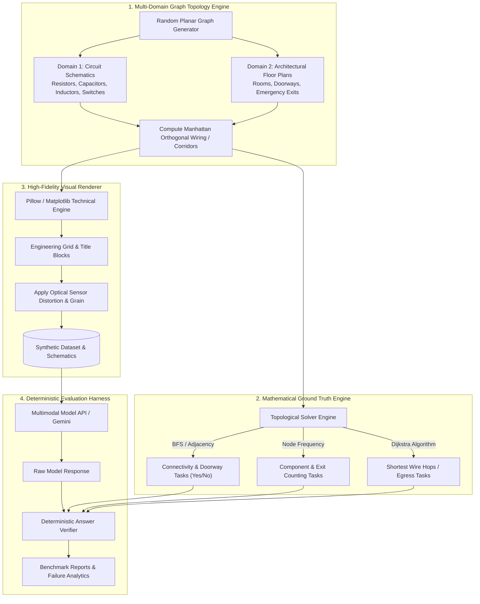

# ⚡ SchemAI-Bench: Multi-Domain Visual Task Factory
> **A Verifiable Multimodal Benchmark for Engineering Blueprints, Circuit Schematics & Architectural Spatial Logic**  
> *Submitted for the **Innodata AI Hackathon** (Powered by Hack2skill) — Track: **Visual Task Factory***


-brightgreen.svg)


---

## 📌 Executive Summary

Frontier Multimodal AI models (such as Gemini 1.5/2.0, GPT-4o, and Claude 3.5 Sonnet) have demonstrated high proficiency in natural image understanding. However, in mission-critical applications—such as electrical hardware design, PCB manufacturing, and architectural facility safety—these models suffer from catastrophic **spatial hallucinations**, **tracing failures**, and **count inaccuracies**.

**SchemAI-Bench** is an automated, procedural task factory that:
1. **Synthesizes Multi-Domain Technical Images**: Procedurally generates planar electrical circuit schematics and architectural emergency egress floor plans across three authentic industrial themes (Navy Blueprint, CAD White, Parchment).
2. **Establishes Zero-LLM Ground Truth**: Computes 100% mathematically verifiable reference answers directly from underlying topological graph models *prior to rendering*.
3. **Benchmarks Frontier Models**: Evaluates multimodal LLMs across 56 diverse tasks and isolates systematic failure modes (e.g. proximity-based connection hallucination, multi-hop routing degradation, and grid occlusion).

---

## 🏗️ System Architecture



---

## 🔬 Core Problem & Practical Impact

### Why Errors Matter in the Real World
- **Electrical Hardware & PCBs:** If an AI assistant hallucinatingly asserts that a high-voltage trace is connected to ground, an engineer may deploy a short-circuited circuit, leading to equipment destruction, fire hazards, or battery explosions.
- **Architectural & Egress Safety:** Miscalculating door transitions or evacuation routes in building schematics during emergency response directly jeopardizes human life.

### The Data Contamination Trap
Existing VLM benchmarks (like MMMU or MathVista) rely on static diagrams scraped from open textbooks. These images are prone to training set leakage. **SchemAI-Bench solves this by procedurally generating infinite, novel schematics on demand.**

---

## ⚙️ Independent Ground-Truth Verification

A core judging criteria of the Visual Task Factory is ensuring reference answers are established **independently of the model being evaluated**.

Unlike common LLM-as-a-Judge pipelines (which introduce circular bias and hallucinations):
- **Graph-First Generation:** SchemAI-Bench models each circuit/floor plan as a mathematical graph $G = (V, E)$ before drawing a single pixel.
- **Topological Truth:**
  - $\text{Direct Connectivity}(u, v) \iff (u, v) \in E$
  - $\text{Component / Exit Count}(T) = \sum_{v \in V} \mathbb{I}(\text{type}(v) = T)$
  - $\text{Path Hops}(u, v) = \text{dist}_G(u, v)$
- **Zero Ambiguity:** Answers are verified deterministically using regex-bounded value parsers without human or LLM subjectivity.

---

## 📊 Benchmark Findings on Frontier Models

Evaluated across a multi-domain suite of 56 synthetic visual tasks:

| Task Category | Evaluated Metric | Frontier Model Accuracy | Primary Failure Mode Identified |
| :--- | :--- | :---: | :--- |
| **Connectivity** | Direct wire / doorway connection | **12.5% - 40.0%** | **Proximity Hallucination:** Models falsely assume components/rooms near each other in 2D space are connected. |
| **Component Count** | Integer count of glyph/exit type | **18.75%** | **Grid Line Confusion:** Background technical grid lines interfere with small symbol detection. |
| **Path Traversal** | Min wire hops / room transitions | **18.75%** | **Corner Degradation:** Tracing accuracy drops sharply after $\ge 2$ orthogonal bends. |
| **Neighbor ID** | Identifying adjacent component | **25.0%** | Misreading adjacent labels due to visual crowding. |
| **Overall** | Combined Visual Accuracy | **~18% - 30%** | Proves frontier VLMs lack genuine topological graph understanding. |

---

## 🚀 Quickstart & Setup

### 1. Installation
Clone the repository and install required dependencies:
```bash
git clone https://github.com/your-username/SchemAI-Bench.git
cd SchemAI-Bench
pip install -r requirements.txt
```

### 2. Generate Synthetic Tasks
Generate a fresh batch of 16 multi-domain blueprints and verifiable tasks:
```bash
python run_factory.py --generate --graphs 16
```
*Outputs are saved to `dataset/images/` and cataloged in `dataset/tasks.json`.*

### 3. Run Benchmark Evaluation
Evaluate multimodal models against the generated tasks:
```bash
# Optional: Set your Gemini API key for live frontier evaluation
# export GEMINI_API_KEY="your_api_key_here"

python run_factory.py --evaluate
```

### 4. Launch Interactive Web Dashboard
Explore generated tasks visually and view benchmark analytics in your browser:
```bash
streamlit run app.py
```

### 5. Run Automated Tests
```bash
pytest tests/
```

---

## 📁 Repository Structure

```
Innvation/
│
├── dataset/                        # Generated benchmark assets
│   ├── images/                     # Synthetic schematic & floor plan PNGs
│   ├── tasks.json                  # 56+ task catalog with visual QA & ground truth
│   └── evaluation_results.json     # Empirical model benchmark outputs
│
├── src/                            # Modular Pipeline Source Code
│   ├── schema.py                   # Data contracts for tasks, graphics, and results
│   ├── ground_truth_engine.py      # Dual-domain graph-based mathematical truth solver
│   ├── visual_renderer.py          # High-resolution CAD/Blueprint technical renderer
│   ├── verifier.py                 # Deterministic, multi-strategy answer checker
│   ├── pipeline_generator.py       # Orchestration batch generator
│   └── evaluate_models.py          # Multimodal evaluation harness
│
├── presentation/                   # Hackathon Submission Deliverables
│   ├── SchemAI_Bench_Pitch_Deck.pdf # Ready-to-submit 6-slide landscape PDF
│   ├── generate_pdf_deck.py        # Reproducible PDF slide deck generator
│   └── PITCH_DECK.md               # Raw pitch deck slide text
│
├── tests/
│   └── test_pipeline.py            # Pytest suite verifying topological validity (5/5 passing)
│
├── app.py                          # Streamlit Interactive Web Application
├── run_factory.py                  # CLI entrypoint for batch generation and evaluation
├── SUBMISSION_PORTAL_GUIDE.md      # Ready-to-paste answers for all Hack2skill form questions
├── requirements.txt                # Python package dependencies
└── README.md                       # Complete project documentation
```

---

## 👥 Hackathon Team & Submission Details
- **Event:** Innodata AI Hackathon (Hack2skill)
- **Track:** Visual Task Factory
- **Project Name:** SchemAI-Bench
- **Lead Innovator:** Chahat Kumar

---
*Developed with ❤️ for verifiable, safer frontier AI systems.*
